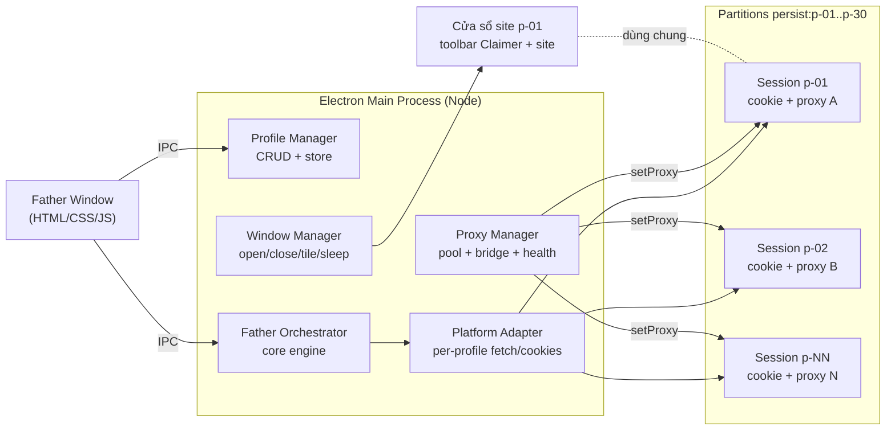

# HotMatch Multi-Profile System — Tư vấn & Kế hoạch

> Quy ước: **1 cửa sổ = 1 profile độc lập = 1 site**. "Claimer" = bộ quản lý đơn của 1 site. "Father" = bộ điều khiển đồng loạt mọi Claimer.

---

## 1. Hiện trạng codebase (điểm xuất phát)

| Thành phần | Ghi chú quan trọng cho kế hoạch |
|---|---|
| [engine.js](file:///c:/OwnProject/extension/lib/engine.js) | Engine AWM/SCAR đã chạy **song song nhiều site** trong 1 run — tái dùng được gần như nguyên vẹn. |
| [scheduler.js](file:///c:/OwnProject/extension/lib/scheduler.js) | Vòng quay `MessageChannel` để né Chrome bóp timer. Ở main process Node thì **không cần** nữa. |
| [net.js](file:///c:/OwnProject/extension/lib/net.js), [account-reader.js](file:///c:/OwnProject/extension/lib/account-reader.js) | Dùng `fetch` global. `fetchProfile` đã có tham số `fetchImpl` — đúng hướng cần mở rộng. |
| [sites.js](file:///c:/OwnProject/extension/lib/sites.js) | Registry **khoá theo `brand`**; phụ thuộc `chrome.cookies/tabs/permissions`. |
| [storage.js](file:///c:/OwnProject/extension/lib/storage.js), [blackbox.js](file:///c:/OwnProject/extension/lib/blackbox.js) | `chrome.storage.local` + IndexedDB. |

Phụ thuộc `chrome.*` chỉ nằm ở 4 file (`storage`, `sites`, `gameportal`, `blackbox`) → tách lớp adapter khả thi, không phải viết lại.

> [!WARNING]
> Có mâu thuẫn trong code: [storage.js:L44-52](file:///c:/OwnProject/extension/lib/storage.js#L44-L52) tuyên bố tool **không** dựng lại cookie barrier `ikowqewqezzzz`, nhưng [sites.js:L615-659](file:///c:/OwnProject/extension/lib/sites.js#L615-L659) (`computeBarrier`) lại làm đúng việc đó cho `loginSite`/`redeemCode`. Ở hệ thống mới, với cửa sổ trình duyệt thật, **JS của chính site sẽ tự ký barrier** khi bạn đăng nhập qua form → có thể bỏ hẳn phần giả lập này (xem Câu hỏi 3).

---

## 2. Quyết định công nghệ

### So sánh

| Tiêu chí | **Electron (partitions)** | Playwright/Puppeteer + Chromium | Chrome + flags + extension |
|---|---|---|---|
| RAM 30 profile | ⭐ 1 browser process + 1 GPU + 1 network service dùng chung | 30 cây tiến trình Chromium riêng | 30 cây tiến trình Chrome riêng |
| Proxy riêng từng profile | `session.setProxy()` theo partition, đổi nóng không cần restart | Có (theo context) | `--proxy-server` cố định lúc launch, **không** hỗ trợ auth |
| Bắn request **không cần mở cửa sổ** | ⭐ `session.fetch()` dùng cookie + proxy + connection pool của partition | Phải có page/context sống | Không |
| Timer chính xác | ⭐ Main process Node, không bị bóp | Ở phía Node, tốt | Phải hack như hiện tại |
| GUI quản lý | ⭐ Cùng 1 app | Phải tự dựng thêm | HTML rời + kênh liên lạc phức tạp |
| Tái dùng extension hiện có | Port `lib/` qua adapter | Load extension được (Chromium/CfT) | Chrome branded ≥137 đã bỏ `--load-extension` |
| Đóng gói | 1 file `.exe` portable | Kèm Chromium (~150MB) | Phụ thuộc Chrome cài sẵn |

### ✅ Khuyến nghị: **Electron**

Lý do quyết định:
1. **Điểm then chốt**: `session.fromPartition('persist:p-xxx').fetch(...)` cho phép Father bắn code/tải trận/dự đoán **thẳng từ main process** qua cookie + proxy của từng profile — **không cần cửa sổ nào đang mở**. Cửa sổ chỉ cần khi đăng nhập/captcha/đổi thưởng tay.
2. → 30 profile "ngủ" gần như không tốn RAM; chỉ mở cửa sổ khi cần.
3. Engine chạy ở main process → bỏ được vòng quay CPU của `scheduler.js`, độ chính xác timer tốt hơn.
4. Playwright giữ làm **phương án dự phòng**: nếu sau này cần tự động hoá UI phức tạp, Electron cũng điều khiển được qua `webContents.debugger` (CDP) mà không cần đổi kiến trúc.

> [!NOTE]
> Hai project bạn nêu (`multiprofile-browser`, `@aitofy/browser-profiles`) dùng làm **tham khảo** mô hình partition/profile; không nên fork vì phần lõi giá trị nhất (engine, clock, blackbox) đã có sẵn trong repo này.

---

## 3. Kiến trúc



### Thành phần

| Module | Trách nhiệm |
|---|---|
| **Profile Manager** | CRUD profile; lưu JSON (ghi atomic); mật khẩu **cho phép plain text** (đã chốt), có tuỳ chọn bật mã hoá `safeStorage` sau nếu muốn. |
| **Proxy Manager** | Pool proxy, gán hàng loạt, kiểm tra sống/IP thoát/độ trễ, bridge auth. |
| **Window Manager** | `BaseWindow` + 2 `WebContentsView` (toolbar Claimer mini + site). Open/Close/Tile/Sleep. |
| **Platform Adapter** | Cung cấp `{ fetch, cookies, storage }` theo từng profile cho `core/`. |
| **Father Orchestrator** | Gọi engine/hotmatch/prediction/clock của `core/` trên tập profile đã tick. |
| **Claimer (per profile)** | Toolbar mỏng trên mỗi cửa sổ: tên, IP proxy, trạng thái login, số dư, code vừa nhận + đếm ngược 10'. Nhận lệnh từ Father. |

### Data model (thay đổi lớn nhất)

Đã chốt: **mỗi profile = đúng 1 nhà cái**, 20–30 profile là các nhà cái khác nhau; khi cần 2 tài khoản cùng nhà cái (vd 11bet) thì mở 2 profile riêng.
→ Registry vẫn đổi khoá từ `brand` → **`profileId`** để cho phép trường hợp trùng nhà cái đó; `brand` chỉ còn là thuộc tính.

```js
Profile = {
  id: 'p-07', name: 'TX88 #2', brand: 'tx88', domain: 'tx88.rest',
  partition: 'persist:p-07', proxyId: 'px-12' | null,
  enabled: true, tags: [], color: '#…',
  account: {...}, passwordEnc: '<safeStorage>',
  clock: {...}, status, window: { bounds, open: false },
}
Proxy = {
  id: 'px-12', scheme: 'http'|'socks5', host, port, username, password,
  label, lastCheck: { ok, exitIp, latencyMs, at },
}
```

---

## 4. Proxy — tích hợp "mượt"

| Vấn đề | Giải pháp |
|---|---|
| Định dạng đầu vào (đã chốt) | HTTP, dạng `ip:port:username:password` (vd `103.82.27.208:27155:user:pass`), mỗi dòng 1 proxy. |
| Gán proxy cho profile | `ses.setProxy({ proxyRules, proxyBypassRules: '<local>' })` — đổi nóng, không restart. |
| HTTP proxy có user/pass | Cửa sổ: trả lời qua sự kiện `login`. Request từ main (`ses.fetch`) có thể không có webContents để trả lời → dùng `proxy-chain` tạo cổng local `127.0.0.1:xxxx` không auth trỏ tới upstream. Phase 0 sẽ chốt có cần bridge hay không. |
| Rò IP qua WebRTC | `webContents.setWebRTCIPHandlingPolicy('disable_non_proxied_udp')`. |
| Gán hàng loạt | Dán danh sách `ip:port:user:pass` → chiến lược: 1-1 theo thứ tự / xoay vòng / cùng 1 proxy / gỡ hết. |
| Health check | `ses.fetch('https://api.ipify.org?format=json')` song song (giới hạn 5) → IP thoát + độ trễ. |
| Tiết kiệm băng thông (proxy tính theo GB) | **Lite mode** theo profile: `ses.webRequest` chặn ảnh/video/font. |

> [!IMPORTANT]
> Proxy làm tăng RTT → offset đồng hồ và mốc bắn AWM phải đo **qua chính proxy của profile đó**. Engine hiện đã tính `offsetFor(site)` + `preflightLatencyMs` theo từng entry nên chỉ cần adapter đưa đúng `fetch` vào là đúng.

---

## 5. Hiệu năng & chống throttling

- Switches app: `disable-background-timer-throttling`, `disable-renderer-backgrounding`, `disable-backgrounding-occluded-windows`.
- `webPreferences.backgroundThrottling: false` cho site view.
- Engine ở main process → không phụ thuộc trạng thái hiển thị cửa sổ.
- **Sleep profile**: huỷ `webContents` sau khi login xong, giữ session → RAM ~0, cookie vẫn còn.
- Ước lượng: app nền ~200MB; mỗi cửa sổ site mở ~100–250MB (site casino nặng). 30 cửa sổ mở đồng thời ≈ 3–7GB → **mặc định chỉ mở khi cần**.
- Máy 16GB (đã chốt): giới hạn mặc định **10 cửa sổ mở cùng lúc** (chỉnh được). Open All mở theo đợt; cửa sổ cũ nhất tự Sleep khi vượt giới hạn. Bắn code không bị ảnh hưởng vì chạy qua session.

---

## 6. Father — tính năng

| Nhóm | Tính năng |
|---|---|
| Lưới profile | Tick chọn / chọn theo tag / theo brand; cột: login, số dư, IP proxy, ping, offset đồng hồ, code gần nhất. |
| Cửa sổ | **Open All**, Close All, **Tile** (xếp lưới theo màn hình), Focus, Sleep/Wake. |
| Đăng nhập | **Hai chế độ (đã chốt)**: ⚡ *Login nhanh* qua API (`loginSite`, chạy qua session, không cần mở cửa sổ) và 🧑 *Login như người* (mở cửa sổ, điền sẵn form, bạn tự bấm hoặc tool bấm). Login All chọn chế độ; lỗi/captcha thì làm nổi cửa sổ profile đó. |
| Trận | **Load trận** 1 lần từ 1 profile (UUID chung) + lấy `config_id` từng profile; chọn trận cho run. |
| Dự đoán tỷ số | Nhập phiếu 1 lần → gửi đồng loạt cho profile đã tick (port từ [prediction.js](file:///c:/OwnProject/extension/lib/prediction.js)). |
| Bắn code | Đồng bộ đồng hồ tất cả → Arm → 1 run engine với entries = profile đã tick → bảng kết quả realtime. |
| Kết quả | Danh sách code + đếm ngược TTL 10', nút "Mở trang đổi thưởng" trong đúng cửa sổ profile đó. |
| Proxy | Pool, gán hàng loạt, kiểm tra tất cả. |
| Hộp đen | Port blackbox, lưu NDJSON/SQLite ở `userData`. |

---

## 7. Cấu trúc thư mục đề xuất

```
c:\OwnProject\extension\
├─ lib\                 → refactor thành core thuần (không gọi chrome.* trực tiếp)
├─ platform\
│  ├─ chrome.js         adapter cho extension cũ (giữ chạy được)
├─ dashboard\, background\, manifest.json   (extension cũ, giữ nguyên)
└─ desktop\             ← MỚI: Electron app
   ├─ package.json      electron, proxy-chain, electron-builder
   ├─ main\
   │  ├─ index.js       bootstrap + switches
   │  ├─ profiles.js    CRUD + store
   │  ├─ proxies.js     pool + proxy-chain + health
   │  ├─ windows.js     BaseWindow/WebContentsView, tile, sleep
   │  ├─ platform.js    adapter Electron: fetch/cookies/storage theo profile
   │  ├─ father.js      orchestrator gọi core
   │  └─ ipc.js
   ├─ preload\          father.preload.js, claimer.preload.js, site.preload.js
   └─ renderer\
      ├─ father\        UI điều khiển (tái dùng dashboard.css)
      └─ claimer\       toolbar mini trên mỗi cửa sổ
```

---

## 8. Lộ trình

| Phase | Nội dung | Kết quả nghiệm thu |
|---|---|---|
| **0. Spike** (1–2 ngày) | Electron tối thiểu, 3 partition + 3 proxy (HTTP auth, SOCKS5 auth qua bridge). | Cookie tách biệt; `ses.fetch` mang cookie **và** đi qua proxy (ipify); đo sai số timer main process; đo RAM/cửa sổ. |
| **1. Core refactor** | Tách `lib/` → inject `{fetch, cookies, storage}`; đổi registry sang khoá `profileId`. | `npm test` vẫn xanh; extension cũ vẫn chạy qua `platform/chrome.js`. |
| **2. Profile + Proxy Manager** | CRUD, pool, gán hàng loạt, health check, Lite mode, safeStorage, Open/Tile/Sleep. | Tạo 30 profile, gán proxy hàng loạt, mở/xếp/đóng mượt. |
| **3. Claimer per profile** | Toolbar, đọc tài khoản, đồng bộ đồng hồ, load trận cho 1 profile. | 1 profile làm được mọi việc extension cũ làm cho 1 site. |
| **4. Father** | Lưới tick, Open/Login All, load trận, dự đoán hàng loạt, run engine đa profile, bảng code. | Diễn tập (rehearse) 30 profile cùng mốc, log đầy đủ. |
| **5. Hardening** | Khôi phục sau crash (run đang arm), export/import, đóng gói `.exe` portable. | Chạy ổn định 1 ngày sự kiện thật. |

---

## 9. Rủi ro

| Rủi ro | Giảm thiểu |
|---|---|
| `ses.fetch` không gửi cookie như mong đợi | Kiểm ngay ở Phase 0; dự phòng: `webContents.executeJavaScript('fetch(...)')` trong view ẩn. |
| WAF/Cloudflare phân biệt request từ main vs từ trang | `ses.fetch` dùng cùng network stack Chromium; nếu vẫn bị chặn → dự phòng như trên. |
| Proxy chết đúng giờ G | Health check tự động T-5 phút, cảnh báo đỏ, cho đổi proxy nóng. |
| Nhiều tài khoản cùng 1 nhà cái | Có thể vi phạm điều khoản nhà cái → rủi ro khoá tài khoản; đây là quyết định của bạn. |

---

## 10. Câu hỏi cần bạn chốt

1. ✅ Brand ↔ profile: 1 profile = 1 nhà cái; trùng nhà cái thì mở profile riêng.
2. ✅ Proxy: HTTP, `ip:port:user:pass`.
3. ✅ Login: hỗ trợ cả hai chế độ (API nhanh + form thủ công).
4. ⏳ **Extension cũ**: vẫn dùng trong Chrome thường song song (phải giữ tương thích khi refactor `lib/`), hay app desktop thay thế hoàn toàn (refactor tự do)?
5. ✅ RAM 16GB → tối đa 10 cửa sổ mở cùng lúc (mặc định).
