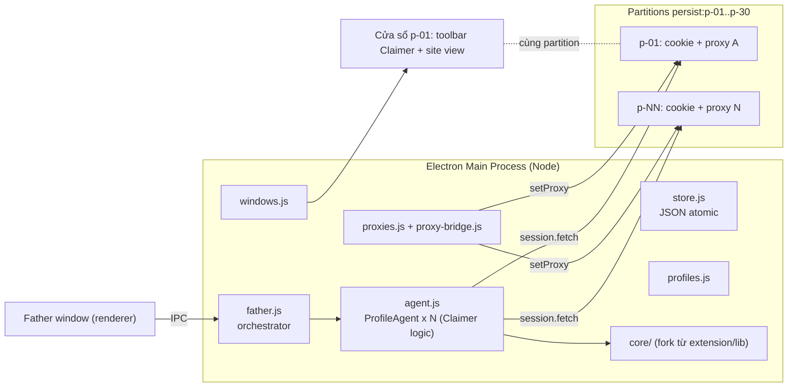

# HotMatch Multi-Profile System — Kế hoạch tổng (MASTER PLAN)

> Tài liệu gốc mà mọi prompt phase đều bám vào. Nếu prompt phase mâu thuẫn với file này, **file này thắng**, trừ khi prompt phase ghi rõ "ghi đè master plan".

Quy ước thuật ngữ:
- **1 cửa sổ = 1 profile độc lập = 1 site** (1 nhà cái, 1 tài khoản).
- **Claimer**: bộ quản lý đơn của 1 profile (thanh công cụ trên cửa sổ + agent logic ở main process).
- **Father** ("HotMatch's Claimer Father"): bộ điều khiển đồng loạt mọi Claimer.
- **Extension cũ**: Chrome extension "HotMatch Claimer" v0.1.2 tại `c:\OwnProject\extension` — **phương án dự phòng, ĐÓNG BĂNG**.

---

## 1. Các quyết định đã chốt

| # | Chủ đề | Quyết định |
|---|---|---|
| D1 | Nền tảng | **Electron**: mỗi profile = 1 partition `persist:<profileId>` (cookie/cache/localStorage/IndexedDB tách biệt). |
| D2 | Vị trí code mới | Thư mục **anh em** `c:\OwnProject\hotmatch-desktop\`, **không** đặt trong thư mục extension (xem §2). |
| D3 | Extension cũ | **Đóng băng + fork**: không sửa bất kỳ file nào của extension. Copy `lib/` sang `hotmatch-desktop/core/` rồi refactor tự do. |
| D4 | Brand ↔ profile | Mỗi profile đúng 1 nhà cái; 20–30 profile là các nhà cái khác nhau. Cần 2 tài khoản cùng nhà cái → tạo 2 profile. ⇒ Mọi registry/kết quả **khoá theo `profileId`**, `brand` chỉ là thuộc tính. |
| D5 | Proxy | HTTP, có auth, định dạng nhập `ip:port:username:password`, mỗi dòng 1 proxy. |
| D6 | Mật khẩu | **Cho phép lưu plain text** trong file dữ liệu cục bộ. UI che mặc định, có nút hiện. |
| D7 | Đăng nhập | **Hai chế độ**: ⚡ Login nhanh qua API (`POST /api/v1/login`, kèm cookie barrier như `loginSite` hiện tại) và 🧑 Login như người (mở cửa sổ thật, điền form, người dùng hoặc tool bấm). |
| D8 | Phần cứng | Máy 16GB RAM → mặc định tối đa **10 cửa sổ site mở cùng lúc** (cấu hình được). |
| D9 | Đường bắn request | Request API (bắn code, tải trận, dự đoán, đọc tài khoản, đồng hồ) đi qua `session.fetch()` của partition từ **main process** — không cần cửa sổ mở. Dự phòng: `webContents.executeJavaScript('fetch(...)')`. Phase 0 xác nhận. |
| D10 | Stack | JavaScript thuần (ESM ở main/core), HTML + Vanilla CSS ở renderer. **Không** React/Vue/Tailwind/TypeScript. |

---

## 2. Vì sao không đặt app desktop trong thư mục extension

Chrome nạp extension unpacked bằng cách quét **toàn bộ** thư mục. `node_modules` của Electron có hàng nghìn file, trong đó có tên bắt đầu bằng `_` (Chrome cấm) → extension dự phòng sẽ **không nạp được nữa**. Vì vậy app desktop phải nằm ở `c:\OwnProject\hotmatch-desktop\`.

Extension cũ **không có git**. Phase 0 phải tạo bản lưu (git init + tag + file zip) trước khi làm bất cứ việc gì khác.

---

## 3. Kiến trúc



| Module (`hotmatch-desktop/`) | Trách nhiệm |
|---|---|
| `core/` | Logic nghiệp vụ fork từ `extension/lib`, **không gọi `chrome.*`**, mọi I/O được inject (`fetchImpl`, `cookies`, backend lưu trữ). |
| `main/store.js` | Đọc/ghi JSON atomic trong `app.getPath('userData')/data/`, hàng đợi ghi tuần tự. |
| `main/profiles.js` | CRUD profile. |
| `main/proxies.js`, `main/proxy-bridge.js` | Pool proxy, parse, gán hàng loạt, health check, cầu nối auth (`proxy-chain`) nếu Phase 0 kết luận cần. |
| `main/windows.js` | `BaseWindow` + 2 `WebContentsView` (toolbar Claimer + site). Open/Close/Tile/Sleep/Focus, giới hạn số cửa sổ. |
| `main/agent.js` | `ProfileAgent`: 1 instance/profile — giữ session, `fetchImpl`, `cookies`, trạng thái; các hành động: đọc tài khoản, đồng bộ đồng hồ, tải trận, login (2 chế độ), dự đoán, mở trang đổi thưởng. |
| `main/father.js` | Chạy hành động trên tập profile được tick (giới hạn song song), điều phối 1 run engine đa profile. |
| `main/ipc.js` | Đăng ký kênh IPC (whitelist). |
| `preload/*.cjs` | `contextBridge` an toàn cho Father, Claimer toolbar, site view. |
| `renderer/father/`, `renderer/claimer/` | Giao diện. Tái dùng design tokens từ `extension/dashboard/dashboard.css`. |

---

## 4. Data model

```js
// data/profiles.json  -> { version: 1, items: { [id]: Profile }, order: [id...] }
Profile = {
  id: 'p-07',                       // duy nhất, không đổi
  name: 'TX88 #2',                  // tên hiển thị
  brand: 'tx88',                    // suy từ domain (brandFromHost), sửa tay được
  domain: 'tx88.rest',              // host hiện tại, không có scheme/path
  domainHistory: ['tx88.rest', 'tx88.games'],
  partition: 'persist:p-07',
  proxyId: 'px-12' | null,
  enabled: true,
  tags: [], color: '#7c5cff',
  username: '', password: '',       // plain text (D6)
  account: null | { uid, username, fullname, phone, balance, vip, ... },  // như accountFromUser
  isLogin: false, accountStale: true, accountCheckedAt: null, accountError: null,
  paths: { promoPath, claimPath },  // DEFAULT_PATHS
  config: {},                       // override cấu hình bắn theo profile (rỗng = dùng chung)
  clock: null | { offsetMs, uncertaintyMs, at, ok },
  liteMode: false,
  window: { bounds: null },
  status: 'idle', createdAt, updatedAt,
}

// data/proxies.json -> { version: 1, items: { [id]: Proxy } }
Proxy = {
  id: 'px-12', scheme: 'http', host: '103.82.27.208', port: 27155,
  username: 'user', password: 'pass', label: '',
  lastCheck: null | { ok, exitIp, latencyMs, at, error },
}
```

Các file khác trong `data/`: `config.json` (DEFAULT_CONFIG + cài đặt app), `matches.json`, `prediction.json`, `runs.json` (50 run gần nhất), `blackbox/` (NDJSON theo ngày + `dictionary.json`).

---

## 5. Proxy

| Vấn đề | Giải pháp |
|---|---|
| Nhập | Parse `ip:port:user:pass` (chấp nhận thêm `ip:port` và `user:pass@ip:port`), bỏ dòng trống/trùng. |
| Gán | `ses.setProxy({ proxyRules, proxyBypassRules: '<local>' })` rồi `ses.closeAllConnections()`; đổi nóng không restart. |
| Auth | Cửa sổ: sự kiện `login` của app/webContents. `session.fetch` từ main có thể không trả lời được auth → dùng `proxy-chain` (`anonymizeProxy`) tạo cổng `127.0.0.1:xxxx` không auth. Phase 0 chốt. |
| Rò IP | `webContents.setWebRTCIPHandlingPolicy('disable_non_proxied_udp')` cho site view. |
| Gán hàng loạt | Chiến lược: 1-1 theo thứ tự / xoay vòng / cùng 1 proxy / gỡ hết — trên tập profile được tick. |
| Health check | `ses.fetch('https://api.ipify.org?format=json')` (giới hạn 5 song song) → IP thoát + độ trễ. |
| Băng thông | Lite mode theo profile: `ses.webRequest.onBeforeRequest` chặn `image`, `media`, `font`. |

> Proxy làm tăng RTT → đồng hồ và mốc bắn AWM phải đo **qua chính proxy của profile**. Engine đã tính `offsetFor(site)` và `preflightLatencyMs` theo từng entry; chỉ cần truyền đúng `fetchImpl`.

---

## 6. Hiệu năng & chống throttling

- Switches: `disable-background-timer-throttling`, `disable-renderer-backgrounding`, `disable-backgrounding-occluded-windows`.
- Site view: `webPreferences.backgroundThrottling: false`.
- Engine chạy ở main process.
- Sleep profile: huỷ `webContents` của site view, giữ session (cookie còn nguyên).
- Giới hạn cửa sổ mở (mặc định 10). Vượt giới hạn → Sleep cửa sổ lâu không dùng nhất.
- Khi có run đang arm: `powerSaveBlocker.start('prevent-app-suspension')`.

---

## 7. Father — tính năng

| Nhóm | Tính năng |
|---|---|
| Lưới profile | Tick chọn / chọn tất cả / theo tag; cột: tên, domain, login, số dư, proxy IP, ping, offset đồng hồ, trạng thái cửa sổ, code gần nhất. |
| Cửa sổ | Open All, Close All, Tile (xếp lưới theo màn hình), Focus, Sleep/Wake. |
| Đăng nhập | Login All với chọn chế độ ⚡ API / 🧑 Form; lỗi/captcha → làm nổi cửa sổ profile đó. |
| Trận | Load trận 1 lần từ 1 profile (UUID chung) + lấy `config_id` từng profile. |
| Dự đoán tỷ số | Nhập phiếu 1 lần → gửi đồng loạt cho profile được tick. |
| Bắn code | Đồng bộ đồng hồ tất cả → Arm → 1 run engine (entries = profile được tick) → bảng realtime. Có Diễn tập. |
| Kết quả | Danh sách code + đếm ngược TTL 10 phút, nút "Mở trang đổi thưởng" trong đúng cửa sổ profile. |
| Proxy | Pool, nhập hàng loạt, gán hàng loạt, kiểm tra tất cả. |
| Hộp đen | Xem log request, gán nhãn chữ ký phản hồi (port từ tab Knowledge/blackbox). |

---

## 8. Cấu trúc thư mục

```
c:\OwnProject\
├─ extension\                    ← ĐÓNG BĂNG (chỉ thêm .git + thư mục prompt\)
└─ hotmatch-desktop\
   ├─ package.json               "type": "module", "main": "main/index.js"
   ├─ .gitignore                 node_modules, dist, spike/proxies.txt, *.local.*
   ├─ core\                      fork từ extension\lib (Phase 1)
   ├─ main\                      index.js, store.js, profiles.js, proxies.js, proxy-bridge.js,
   │                             windows.js, agent.js, father.js, ipc.js, blackbox-store.js, util\
   ├─ preload\                   father.cjs, claimer.cjs, site.cjs
   ├─ renderer\
   │  ├─ shared\                 tokens.css, ui.js
   │  ├─ father\                 index.html, father.css, father.js, views\*.js
   │  └─ claimer\                index.html, claimer.css, claimer.js
   ├─ test\                      core\*.test.js, main\*.test.js
   ├─ spike\                     thí nghiệm Phase 0 (giữ lại để tham khảo)
   └─ docs\                      phase-N-report.md, BACKPORT.md, DECISIONS.md
```

---

## 9. Lộ trình

| Phase | File prompt | Kết quả nghiệm thu |
|---|---|---|
| 0. Spike | `phase-0_spike.md` | Backup extension; xác nhận cô lập cookie, proxy auth, `session.fetch` mang cookie + qua proxy, độ chính xác timer, RAM/cửa sổ. |
| 1. Core fork | `phase-1_core-fork.md` | `core/` không còn `chrome.*`, I/O inject được, khoá theo profileId, test xanh. |
| 2. Profile/Proxy/Window | `phase-2_profiles-proxies-windows.md` | Tạo 30 profile, nhập + gán proxy hàng loạt, mở/xếp/sleep cửa sổ, Father UI khung + tab Profiles/Proxies. |
| 3. Claimer | `phase-3_claimer.md` | 1 profile làm được mọi việc extension cũ làm cho 1 site (đọc tài khoản, login 2 chế độ, đồng hồ, tải trận, toolbar). |
| 4. Father | `phase-4_father.md` | Hành động đồng loạt, dự đoán hàng loạt, run engine đa profile, kết quả + code, hộp đen. |
| 5. Hardening | `phase-5_hardening.md` | Khôi phục sau crash, health check tự động, export/import, đóng gói `.exe` portable. |

---

## 10. Rủi ro

| Rủi ro | Giảm thiểu |
|---|---|
| `session.fetch` không gửi cookie / không qua proxy auth | Phase 0 kiểm; dự phòng `executeJavaScript('fetch')` trong view ẩn. |
| WAF phân biệt request từ main vs từ trang (UA/Client Hints có chữ "Electron") | Phase 0 kiểm header; chuẩn hoá UA ở cấp session. |
| Proxy chết đúng giờ G | Health check tự động T-5 phút, cảnh báo đỏ, đổi proxy nóng. |
| Hai bản code (extension + core) lệch nhau | `docs/BACKPORT.md` ghi mọi sửa lỗi nghiệp vụ ở core có thể cần mang về extension (người dùng tự quyết). |
| Nhiều tài khoản cùng nhà cái | Có thể vi phạm điều khoản nhà cái → rủi ro khoá tài khoản; người dùng chịu trách nhiệm quyết định. |
